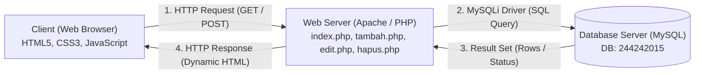
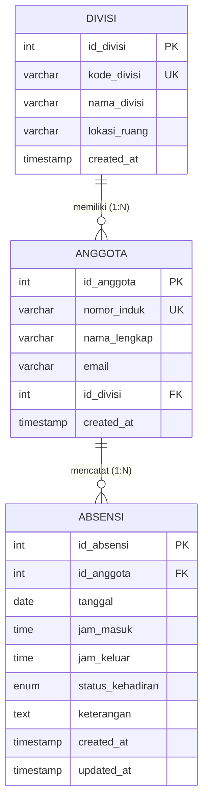

# Sistem Informasi Absensi Berbasis Web (PHP & MySQL) — DB `244242015`

Aplikasi **Sistem Informasi Absensi Web** berbasis PHP Native dan MySQL (MariaDB) yang dirancang untuk berjalan di **Localhost** (XAMPP / Laragon / PHP Built-in Server). Proyek ini disusun untuk memenuhi seluruh indikator capaian pembelajaran **Sub-CPMK 1 hingga Sub-CPMK 7**.

---

## Konfigurasi & Identitas Database

Sesuai spesifikasi, konfigurasi koneksi dan nama database menggunakan **`244242015`**:

| Parameter | Nilai Konfigurasi | Lokasi File |
| :--- | :--- | :--- |
| **Database Host** | `localhost` | `config/database.php` / `koneksi.php` |
| **Database Port** | `3306` | `config/database.php` |
| **Database User** | `root` | `config/database.php` |
| **Database Password** | *(kosong / default XAMPP & Laragon)* | `config/database.php` |
| **Nama Database (`DB_NAME`)** | **`244242015`** | `config/database.php` & `244242015.sql` |
| **Driver Database** | `MySQLi Extension` (Prepared Statements) | `config/database.php` |

> **Fitur Auto-Setup & Auto-Seeder:** Saat aplikasi pertama kali dibuka di browser (`index.php`), skrip `config/database.php` secara otomatis akan membuat database **`244242015`**, membuat ke-3 tabel berelasi (`divisi`, `anggota`, `absensi`), dan mengisi data awal jika belum tersedia. Anda juga tetap dapat mengimpor file [`244242015.sql`](./244242015.sql) secara manual melalui **phpMyAdmin**.

---

## Pemetaan Capaian Pembelajaran (Sub-CPMK 1 – Sub-CPMK 7)

| No | Kode | Materi Pokok | Implementasi pada Proyek | Indikator Capaian |
| :-: | :--- | :--- | :--- | :--- |
| **1** | **Sub-CPMK 1** | Web Database Architecture & Environment Setup (XAMPP/Laragon) | Dokumentasi alur Client-Server, konfigurasi server lokal Apache/PHP & MySQL, serta panel indikator status server di atas halaman. | Environment siap *running* di `localhost`. |
| **2** | **Sub-CPMK 2** | Database Design: Normalisasi & Relasi Tabel (ERD Review) | Skema database `244242015` ternormalisasi hingga **3NF** terdiri dari 3 tabel berelasi: `divisi` (1:N) `anggota` (1:N) `absensi`. | ERD logis, memiliki *Primary Key* & *Foreign Key* yang normal. |
| **3** | **Sub-CPMK 3** | Database Connectivity: Connection Strings & Driver DB | File `config/database.php` & `koneksi.php` menggunakan driver `mysqli` dengan *error handling* kegagalan koneksi dan *badge* status koneksi aktif. | Status koneksi sukses (`Terhubung ke database '244242015'`). |
| **4** | **Sub-CPMK 4** | CRUD Part 1: Data Insertion & Form Handling (**Create**) | Form input presensi pada `tambah.php` dan *Quick Create* pada `index.php` menggunakan validasi input & *Prepared Statement* `INSERT INTO`. | Data tersimpan dengan aman di DB `244242015`. |
| **5** | **Sub-CPMK 5** | CRUD Part 2: Data Retrieval & Displaying Table (**Read**) | Tabel HTML dinamis pada `index.php` menampilkan data hasil `INNER JOIN` 3 tabel dengan pengurutan waktu terbaru (`ORDER BY tanggal DESC, jam_masuk DESC`) & fitur filter. | Data tampil dinamis dan sesuai urutan. |
| **6** | **Sub-CPMK 6** | CRUD Part 3: Data Updating & Form Pre-filling (**Update**) | Halaman `edit.php?id={id_absensi}` mengambil data spesifik berdasarkan ID, mengisi nilai awal ke dalam form (*form pre-filling*), dan mengeksekusi query `UPDATE`. | Record terupdate dengan benar sesuai ID. |
| **7** | **Sub-CPMK 7** | CRUD Part 4: Data Deletion & Confirmation Alerts (**Delete**) | Tombol hapus memicu dialog konfirmasi JavaScript (`confirmDeleteAbsensi` di `assets/script.js`) sebelum mengeksekusi `hapus.php?id={id_absensi}` (`DELETE FROM`). | Notifikasi konfirmasi tampil & data terhapus permanen. |

---

## 1. Arsitektur Web Database (Sub-CPMK 1)

Aplikasi bekerja menggunakan arsitektur **Three-Tier Client-Server** pada lingkungan lokal (`localhost`):



1. **Client Tier (Browser):** Mengirimkan permintaan HTTP (`GET` untuk melihat/filter data, `POST` untuk mengirim form tambah/edit) serta menampilkan peringatan konfirmasi hapus (*Confirmation Alert*).
2. **Application/Server Tier (PHP Engine):** Memvalidasi input pengguna, memuat skrip koneksi `config/database.php`, dan mengeksekusi *Prepared Statements* melalui ekstensi `MySQLi`.
3. **Database Tier (MySQL Server):** Menyimpan data secara persisten di dalam database **`244242015`** dengan integritas referensial (*Foreign Key*).

---

## 2. Desain Skema Database & ERD (Sub-CPMK 2)

Skema database **`244242015`** telah dinormalisasi hingga **Bentuk Normal Ketiga (3NF)** untuk mencegah redundansi data:
- **1NF:** Setiap kolom bernilai atomik dan memiliki *Primary Key*.
- **2NF:** Seluruh atribut non-kunci bergantung penuh pada *Primary Key* masing-masing tabel.
- **3NF:** Tidak ada ketergantungan transitif (informasi nama kelas/divisi dan lokasi ruangan dipisahkan ke tabel `divisi`, sedangkan biodata mahasiswa/pegawai dipisahkan ke tabel `anggota`).

### Entity Relationship Diagram (ERD)



---

## 3. Struktur Direktori Proyek

```text
utsphprivan/
├── config/
│   └── database.php       # Konfigurasi koneksi DB 244242015, error handling & auto-migrate (Sub-CPMK 3)
├── assets/
│   ├── style.css          # Styling antarmuka modern & responsif
│   └── script.js          # Fungsi Confirmation Alert penghapusan data & jam real-time (Sub-CPMK 7)
├── 244242015.sql          # File SQL dump struktur tabel 3NF & data seeder awal (Sub-CPMK 2)
├── koneksi.php            # Wrapper koneksi database utama (Sub-CPMK 3)
├── index.php              # Dashboard utama, Statistik, Quick Create, & Tabel Dinamis (Sub-CPMK 4 & 5)
├── tambah.php             # Halaman Form Input Presensi Baru (Sub-CPMK 4 - Create)
├── edit.php               # Halaman Edit Presensi & Form Pre-filling berdasarkan ID (Sub-CPMK 6 - Update)
├── hapus.php              # Eksekusi Hapus Data Permanen berdasarkan ID (Sub-CPMK 7 - Delete)
├── anggota.php            # Halaman Manajemen Anggota & Divisi (Demonstrasi Relasi Tabel Sub-CPMK 2)
└── README.md              # Dokumentasi lengkap aplikasi & panduan instalasi
```

---

## 4. Cara Menjalankan Aplikasi di Localhost

### Opsi A: Menggunakan XAMPP / Laragon (Direkomendasikan)

1. Pastikan layanan **Apache** dan **MySQL** pada XAMPP atau Laragon sudah berstatus **Running / Started**.
2. Salin atau letakkan folder proyek `utsphprivan` ke dalam direktori server web:
   - **XAMPP:** `C:\xampp\htdocs\utsphprivan`
   - **Laragon:** `C:\laragon\www\utsphprivan`
3. *(Opsional)* Buka `http://localhost/phpmyadmin`, lalu impor file **`244242015.sql`**.  
   *(Langkah ini opsional karena aplikasi akan otomatis membuat database `244242015` beserta tabel dan contoh datanya saat pertama kali diakses).*
4. Buka browser dan akses URL:
   ```text
   http://localhost/utsphprivan/
   ```

### Opsi B: Menggunakan PHP Built-in Web Server (Tanpa pindah folder)

1. Pastikan service **MySQL** (dari XAMPP/Laragon) sudah berjalan di port `3306`.
2. Buka terminal (PowerShell / CMD) pada direktori proyek ini, lalu jalankan:
   ```powershell
   php -S localhost:8000
   ```
3. Buka browser dan akses URL:
   ```text
   http://localhost:8000
   ```

---

## 5. Cuplikan Kode Konfigurasi Koneksi (`config/database.php`)

```php
define('DB_HOST', 'localhost');
define('DB_USER', 'root');
define('DB_PASS', '');
define('DB_NAME', '244242015');
define('DB_PORT', 3306);

$conn = @new mysqli(DB_HOST, DB_USER, DB_PASS, '', DB_PORT);
```

Jika koneksi berhasil, bagian atas halaman akan menampilkan indikator hijau:
> **Status Koneksi Sukses — Terhubung ke database '244242015' pada localhost (Driver: MySQLi)**
